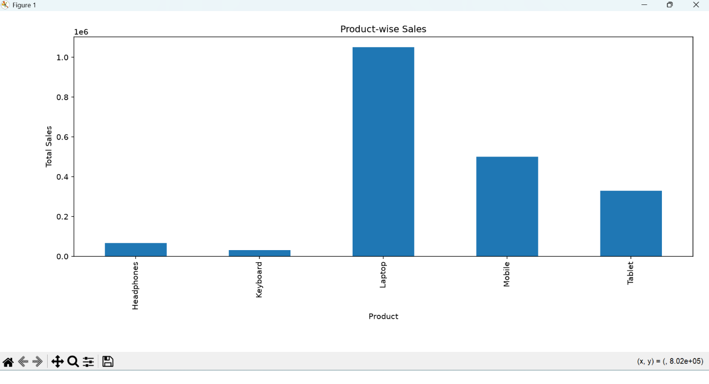
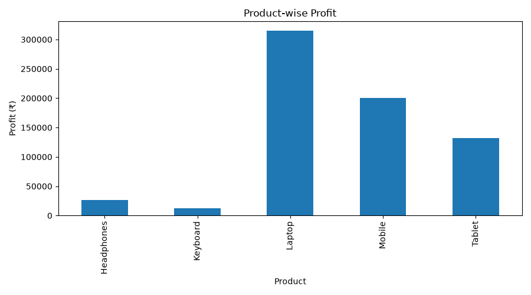
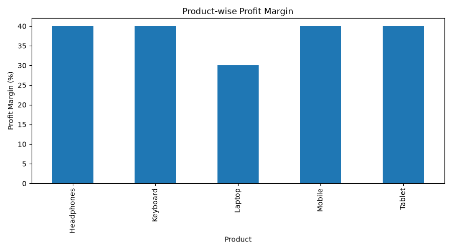

# Python E-Commerce Sales Analysis

## Project Overview
This project analyzes e-commerce sales data using Python and Pandas. The analysis focuses on total sales, total profit, product-wise performance, and profit margins.

## Tools Used
- Python
- Pandas
- Matplotlib
- VS Code

## Analysis Performed
- Calculated total sales
- Calculated total profit
- Compared sales and profit by product
- Calculated product-wise profit margin
- Created data visualizations

## Key Results
- Total Sales: ₹19,77,000
- Total Profit: ₹6,85,800
- Products analyzed: Laptop, Mobile, Tablet, Headphones, Keyboard

## Visualizations

### Product-wise Sales

### Product-wise Profit

### Product-wise Profit Margin

## Project Files
- `sales_analysis.py` — Python analysis code
- `Product_Wise_Sales_Chart.png` — Sales visualization
- `Product_Wise_Profit_Chart.png` — Profit visualization
- `Product_Wise_Profit_Margin_Chart.png` — Profit margin visualization
